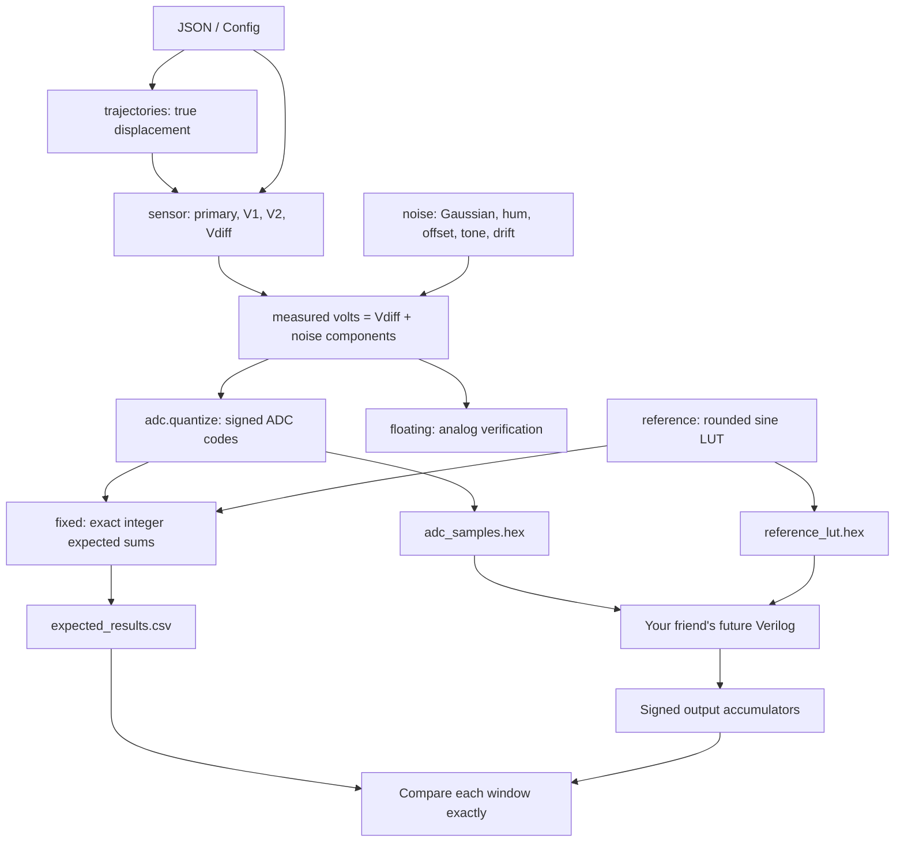

# Explain this project to your Verilog teammate

Read this guide first, then the numbered source walkthroughs. Those walkthroughs
show each original source line next to its explanation, including imports,
validation, tests, and configuration. They are a snapshot of the source at the
time of this explanation; if source changes, line numbers may move.

- [Core Python, line by line](CORE_LINE_BY_LINE.md)
- [Command scripts, line by line](SCRIPTS_LINE_BY_LINE.md)
- [Tests, line by line](TESTS_LINE_BY_LINE.md)
- [JSON, packaging and dependencies, line by line](CONFIG_LINE_BY_LINE.md)
- [Full setup, repository tree and data contract](../README.md)
- [Previously executed implementation results](../IMPLEMENTATION_REPORT.md)

## The explanation to give your friend

> Python is our virtual sensor and ADC. We tell it the true core position over
> time. It creates the two secondary winding voltages, subtracts them, adds
> interference, and turns the result into signed ADC numbers. Your Verilog
> receives those numbers, multiplies them by the supplied sine lookup table,
> and adds 200 products. Python also gives you the exact sum you should get.
> Match that integer sum first; then convert it to displacement.

The handoff is through **files**, and through ordinary Python function calls if
you import the package. There is no live wire, serial driver, network endpoint,
HDL co-simulation bridge, or implemented Verilog module in this repository.

For the default +2 mm case, tell the physical story with numbers:

```text
Differential peak amplitude = K*x = 0.24*2 = 0.48 Vpeak
Secondary 1 peak amplitude  = 2.0 + 0.48/2 = 2.24 Vpeak
Secondary 2 peak amplitude  = 2.0 - 0.48/2 = 1.76 Vpeak
Subtract the waveforms     -> (2.24 - 1.76)*sin(...) = 0.48*sin(...)
```

At sample n=5, the carrier reaches its positive peak: t=5/20000=0.00025 s.
With noise/phase disabled, the ADC sees +0.48 V and rounds
0.48*2048/2.5=393.216 to code 393. The reference entry is 16384, so that one
product is 6,438,912. The complete 200-sample sum is 644,177,200. Other samples
have other amplitudes, so a window sum is not 200 times that peak product.
For -2 mm the secondary amplitudes exchange, the differential waveform reverses,
and correlation gives the negative sum. At null both secondaries are the same.

## Python notation you will see throughout

| Syntax or library | How to explain it |
|---|---|
| `import numpy as np` | Load numerical-array tools under the short name np |
| `NDArray` | A type annotation describing a NumPy array; it does not allocate data |
| `def f(x: float) -> int` | Define a function; annotations describe expected input/output types |
| `@dataclass(frozen=True)` | Build a convenient data record; fields cannot be reassigned, but contained arrays/dictionaries can still be modified |
| `@property` | Calculate a value when accessed as an attribute, e.g. cfg.sample_count |
| `@classmethod` | A method called on a class, e.g. Config.load; receives the class as cls |
| `asdict(config)` | Convert configuration fields into a dictionary for metadata |
| `replace(config, field=value)` | Make a changed copy of a dataclass and run its constructor/validation |
| `np.arange(M)` | Make integer positions 0 through M-1 |
| `np.full(M, value)` | Repeat a constant value M times |
| `np.linspace(a,b,M)` | Make M evenly spaced values, including both endpoints |
| `x * carrier` | Multiply corresponding array samples; NumPy handles the full vector |
| `x**3` | Cube each sample; ** is exponentiation |
| `a[:complete]` | Slice from index zero up to, but excluding, complete |
| `.reshape(-1,N)` | Group samples into N-column window rows; infer the number of rows |
| `.sum(axis=1)` or `.mean(axis=1)` | Sum or average each window row, producing one result per row |
| `//` | Integer floor division, used to count complete windows |
| `%` | Remainder, used to wrap a reference index modulo the LUT length |
| `1 << 14` | Integer left shift, giving 2^14=16384 |
| `int(v) & 0xffff` | Keep the low 16 bits so negative numbers can be written as two's-complement HEX |
| `.astype(np.int64)` | Promote elements to signed 64-bit storage before arithmetic that could overflow smaller types |
| `np.rint` | Round to nearest integer value, with exact half-way ties going to the even integer |
| `np.clip(v,lo,hi)` | Saturate values below/above bounds; used for ADC voltage/codes, not physical displacement |
| `np.any`, `np.all` | Check whether any sample, or every sample, satisfies a condition |
| `mask`, `~mask` | Boolean selection array and its inverse; select clipped or nonclipped samples |
| `list/dict comprehensions` | Compact loops that collect values into a new list/dictionary |
| `Path(root) / name` | Join filesystem path components portably, not arithmetic division |
| `with ... as handle` | Open/use a file and close it automatically afterward |
| `raise ValueError(...)` | Reject invalid input rather than produce misleading results |
| `if __name__ == "__main__"` | Start a script when executed directly; skip that entry point during import |
| `argparse`, `logging` | Standard-library command-line parsing and progress/error messages |
| `csv`, `json`, `hashlib` | Structured file reading/writing and SHA-256 file fingerprints |
| `matplotlib` | Static engineering plotting; the Agg backend saves PNGs without a window |
| `pytest`, `assert`, `pytest.raises` | Test runner, expected-condition check, and expected-exception check |

Floating array operations are used to simulate sampled voltages. Only the fixed
correlation path must use integer arithmetic exactly. A Python type hint alone
does not enforce range, shape, or signedness; explicit validation and dtype
conversion in the implementation provide those checks.



## Where the connectors are

| Need | Connector | What passes through it |
|---|---|---|
| Choose settings | `Config.load(path)` in `config.py` | JSON becomes a validated Config object |
| Generate everything in memory | `pipeline.run(config, stream_id=0)` | Returns a Simulation object; writes no files |
| Get true displacement | `sim.displacement_mm` | One floating mm value per sample |
| Get individual winding voltages | `sim.sensor.primary_v`, `secondary_1_v`, `secondary_2_v` | Floating V arrays for inspection |
| Get clean differential signal | `sim.sensor.differential_v` | Floating V array before measurement interference |
| Get noisy measurement | `sim.measured_v` | Floating V array at ADC input |
| Get digital input for HDL | `sim.adc.codes` | Signed int16 array; default numerical range -2048 to +2047 |
| Inspect clipping | `sim.adc.clipped_count`, `clipped_percent` | Saturation statistics |
| Generate LUT in memory | `reference.sine_lut(config.lut_length)` | Signed int16 reference codes, scale 16384 |
| Get exact answers | `sim.fixed.accumulator` | Signed int64 sums, one per complete window |
| Get a Python mm estimate | `sim.fixed.displacement_mm` | Final floating conversion of each integer sum |
| Write the handoff | `pipeline.export_simulation(sim, output_dir, name)` | HEX, CSV, JSON files in named directories |
| Check existing output independently | `scripts/audit_exports.py` | Decodes files and recomputes exact sums |
| Convert a future HDL sum to mm | `lockin_reference.accumulator_to_mm(sums, config)` | Use the same configuration/scaling as the input stream |

Read `pipeline.run` first: its short body is the connection diagram in code.
Then read `sensor.simulate`, `adc.quantize`, `reference.sine_lut`, and
`lockin_reference.fixed`. Validation, plotting, and tests support those connectors.

## Generate a signal now

From the repository's `lvdt_project` directory, using the existing local environment:

```powershell
.\.venv\Scripts\python.exe scripts\generate_hdl_vectors.py --config configs\baseline.json --name friend_demo
```

This writes:

```text
output/vectors/friend_demo/adc_samples.hex
output/vectors/friend_demo/reference_lut.hex
output/vectors/friend_demo/expected_results.csv
output/vectors/friend_demo/metadata.json
output/ground_truth/friend_demo/ground_truth.csv
```

The baseline means constant +2 mm, 1 second, fs=20,000 Hz, fc=1,000 Hz,
noise disabled. That is 20,000 ADC words, 20 LUT words, and 100 measurement
results. `--name` is just the output folder name; it does not change physics.
Files in the same named scenario are replaced on rerun.

To generate all ten standard scenarios:

```powershell
.\.venv\Scripts\python.exe scripts\generate_scenarios.py --config configs\baseline.json --all
```

For a custom signal, copy a JSON config to a new filename and change its values.
Do not edit the waveform arrays in HEX by hand if you want matching ground truth.
For example, this complete config produces a noisy step:

```json
{
  "duration_s": 1.0,
  "seed": 42,
  "noise_std_v": 0.1,
  "trajectory": {
    "mode": "step",
    "before_mm": -2.0,
    "after_mm": 2.0,
    "step_s": 0.5
  }
}
```

Run your new config without `--all`: standard scenarios intentionally override
noise/phase/nonlinearity and trajectory settings. Omitted JSON keys use Config's
defaults. Mechanical sine `trajectory.frequency_hz` describes motion; `fc_hz`
describes the electrical carrier. They serve different purposes.

## Generate and reuse signals from Python

Use these statements in your own Python script after installing the package:

```python
from pathlib import Path
import numpy as np
from lvdt_sim.config import Config
from lvdt_sim.pipeline import run, export_simulation
from lvdt_sim.reference import sine_lut
from lvdt_sim.lockin_reference import accumulator_to_mm

cfg = Config.load("configs/baseline.json")  # Read settings; apply defaults/validation.
sim = run(cfg, stream_id=0)                 # Generate one independently reset stream.
t = sim.time_s                             # Seconds, shape (20000,) for this config.
volts = sim.measured_v                      # Noisy analog-equivalent sampled voltage.
adc_codes = sim.adc.codes                   # These signed values are the HDL input.
lut = sine_lut(cfg.lut_length)              # Signed 20-entry Q1.14 table.
expected_sums = sim.fixed.accumulator       # Exact per-window answers.
paths = export_simulation(sim, Path("output"), "python_demo")
print(paths, int(expected_sums[0]))          # First clean +2 mm sum: 644177200.

hdl_sums = np.array([644177200], dtype=np.int64)  # Example captured from future HDL.
print(accumulator_to_mm(hdl_sums, cfg))           # Approximately +1.999789228 mm.
```

`run` is an offline batch simulation; it does not yield one clock edge at a time.
Each array index represents one accepted sample. Feed those values to a future
testbench in order. The waveform's first accepted sample has index zero.

## What your friend should build

A useful future RTL boundary has a clock/reset, a signed 16-bit ADC sample input,
an input sample-valid flag, a signed accumulator output of at least 40 bits, and
an output-valid flag. These are proposed signal roles, not ports already defined
by this Python project. Your friend chooses their names and implementation.

The algorithm for an accepted sample is:

```text
product = signed(adc_sample) * signed(lut[reference_index])
next_sum = running_sum + product

if this is accepted sample 200 of the current window:
    output next_sum and mark the result valid
    clear running_sum and window count
else:
    store next_sum and increment the window count

advance reference_index modulo 20
```

On an invalid clock, consume no sample, add nothing, and advance neither count
nor phase. Valid output timing must be specified by the HDL implementation;
the Python CSV checks completed sums, not an HDL clock-latency waveform.

Reference phase resets only at the beginning of a new independent stream, not
at every arbitrary chunk. The default 200-sample window is ten carrier cycles,
so its next reference index happens to be zero anyway. That is a mathematical
coincidence of these settings, not permission to reset phase for every other
window size. Reset also clears the accumulator/count and deasserts output valid.

If HDL uses a pipelined multiplier, sample count and output-valid must follow
the products through that pipeline. The last product still belongs to its
original window. Python does not implement or verify that pipeline latency.

## The four handoff files

| File | How your friend uses it |
|---|---|
| `adc_samples.hex` | Load input memory with `$readmemh`; present one signed word per accepted sample |
| `reference_lut.hex` | Load the exact rounded sine table; use the same ordering and scaling |
| `expected_results.csv` | Skip the CSV header; compare each HDL signed sum with `expected_accumulator` |
| `metadata.json` | Read configuration, lengths, scales, clipping, units, and format version |

`ground_truth.csv` is for debugging and analysis: it records all physical voltages,
position, times, and codes. It is not an additional input to the lock-in datapath.
PNG files, Markdown reports, XML test results, and audit hashes are diagnostics.

Useful decimal/HEX examples:

| Decimal meaning | HEX word | Interpretation |
|---:|---|---|
| 0 | `0000` | Zero ADC sample or zero LUT coefficient |
| +1 | `0001` | One ADC code, not one volt |
| -1 | `FFFF` | Sign-extended negative one |
| -2048 | `F800` | Negative ADC full-scale code |
| +2047 | `07FF` | Largest positive default ADC code |
| +16384 | `4000` | Reference +1.0 after dividing by 16384 |
| -16384 | `C000` | Reference -1.0 after dividing by 16384 |

The same 16-bit container is used for two different scales. A LUT word is not
an ADC code. `$readmemh` loads bits; signed declarations/casts determine signed
arithmetic. A signed 32-bit product is sufficient for the two 16-bit operands;
sign-extend it into the accumulator. Do not truncate the product back to 16 bits.

For defaults, the conservative product bound is 33,554,432 and window sum bound
6,710,886,400. A signed 40-bit accumulator has ample capacity. Compare integer
sums first. Their conversion to mm is:

```text
x_mm = (2*S/(200*16384)) * (2.5/2048) / 0.24
```

The 2 removes the mean sine-squared factor of 1/2. Dividing by 16384 removes
the LUT scale; 2.5/2048 converts ADC codes to volts; division by 0.24 converts
peak differential volts to mm. Baseline +2 mm yields S=644177200; -2 mm gives
S=-644177200; null gives S=0 for each clean 200-sample window.

## Timing, verification, and mistakes to avoid

200 samples at 20 kHz span a nominal 10 ms window. First/last sample times are
0 and 9.95 ms, so the reported center is 4.975 ms. A result needs the last
sample plus any HDL processing latency. CSV end_sample is inclusive. Trailing
incomplete windows are discarded from results; their ADC samples are retained.

Suggested verification order: null, positive, negative, full calibration,
then noise, phase, interference, motion, clipping, and inserted valid gaps.
Check memory paths relative to the simulator's working directory, signedness,
first LUT index, inclusion of sample 199, and integer output width if sums differ.
If sums agree but mm differs, check engineering-unit conversion and config.

```powershell
.\.venv\Scripts\python.exe scripts\run_validation.py
.\.venv\Scripts\python.exe scripts\audit_exports.py
```

The Python gap test is a behavioral contract check. It does not exercise actual
Verilog or establish hardware timing closure. Build HDL tests for reset during
a partial window, random valid gaps, last-product inclusion, and output timing.

## Where to extend the project

| Change | Place to work | Keep consistent |
|---|---|---|
| Noise, displacement, duration, phase | JSON config | Use Config validation; regenerate outputs |
| New trajectory | `trajectories.generate` and trajectory tests | Same-length finite mm array, configured physical bounds |
| New sensor physics | `sensor.simulate` and sensor tests | V1-V2 identity and explicit units |
| New interference source | `noise.components` and noise tests | Additive V array matching all sample times |
| ADC range/resolution | Config, `adc.py`, tests | Revisit HDL code range, scaling, widths, metadata |
| New carrier/sample ratio | Config, reference generation | fs/fc=LUT length; HDL memory length/indexing |
| Different window length | Config, references, tests | Expected sums, counter width, scaling, timing; preserve global phase |
| Streaming partial buffers | A new processing layer | Existing reference functions discard incomplete tails; do not lose them between chunks |
| HDL core | Separate Verilog project | Match exported accepted-sample and integer arithmetic contract |

Do not change K without updating the matching physical model and mm conversion.
Changing primary_peak_v alone does not change the fixed K/A0 coupling model.
Changing resolution or LUT length in Python alone does not update your friend's
RTL. A negative sign must be retained: taking abs() would lose displacement direction.

The detector remains a single in-phase rectangular correlation. Phase mismatch
scales the ideal answer by cos(phi); coherent same-frequency interference is
ambiguous. Motion is sine-squared weighted over a window. These are model
properties your friend must account for, not evidence that every differing
instantaneous position is an HDL bug.

## Files that do not need source-line explanations

`README.md`, `IMPLEMENTATION_REPORT.md`, and this `docs/` directory are human
documentation, not executable modules. Generated HEX/CSV are repeated records
whose formats are explained above and in README. JSON metadata/reports and XML
test results record run settings/results. PNGs are pictures. `.venv`, caches,
`.pytest_cache`, and egg-info are environment/build products, not project source
to modify or hand-port into Verilog. The line walkthroughs cover every authored
Python file, every supplied JSON configuration, and the packaging/dependency/
ignore files present when this guide was created.
